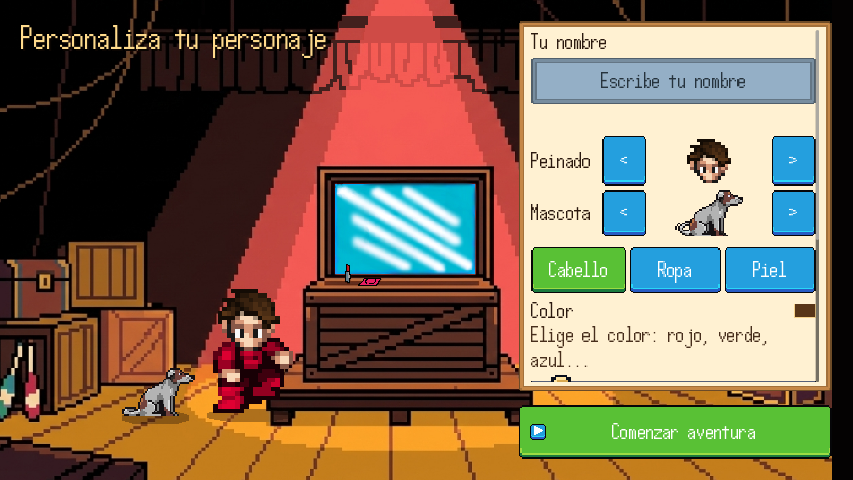
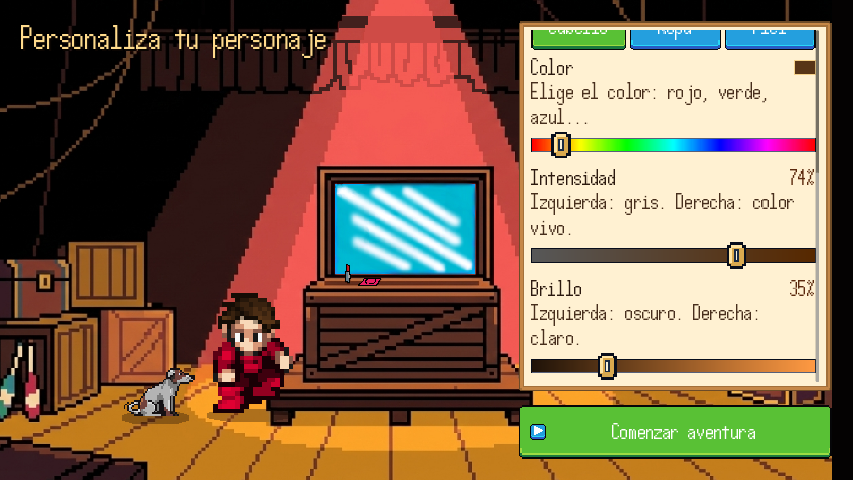
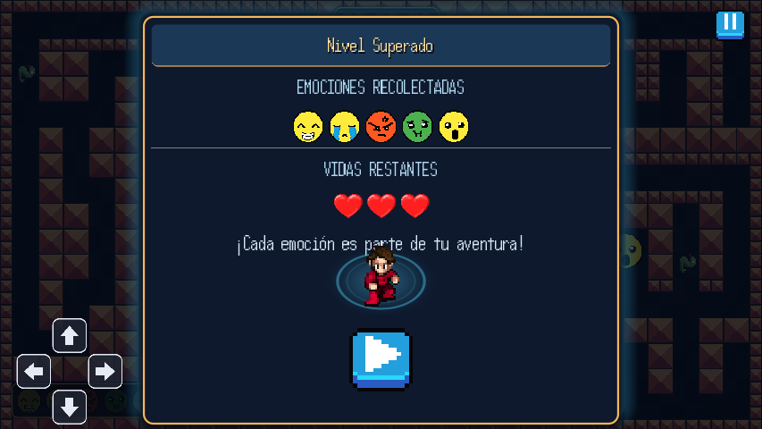

# Personalización y victoria móvil — 15 de noviembre de 2026

Los cambios se aplican únicamente desde el autoload `MobilePresentation`, que
se activa cuando el dispositivo es móvil. Las escenas y la distribución de
escritorio no se modificaron en esta revisión.

En personalización, «Comenzar aventura» queda fijo debajo del panel derecho,
fuera de su ScrollContainer. Se conserva el botón original, su tema pixelado,
las señales y la validación del nombre. El menú mantiene el desplazamiento para
editar todos los colores, con espacio reservado para que el botón no lo tape.

En la victoria del laberinto, Continuar mide 160×160 unidades y mantiene su
proporción cuadrada. Se redujeron los corazones a 80×80 y se ajustó el espacio
del personaje para conservar todo el resumen y la acción sin desplazamiento.

## Verificación

- Render OpenGL Compatibility a 640×360 y 854×480: seis capturas revisadas.
- Presentación móvil: **696 comprobaciones, cero fallos**. Incluye la posición
  fija antes y después de arrastrar, acceso al último ajuste de color y una
  pulsación del botón con nombre vacío para verificar su validación sin guardar.
- Personalización de escritorio: **517 comprobaciones, cero fallos**.
- Flujo móvil: **189 comprobaciones, cero fallos**, incluida la proporción del
  botón de victoria en tres tamaños de ventana. Al cerrar esta ejecución
  headless, Godot informó dos objetos y un recurso pendientes de liberar;
  la ejecución con render terminó sin ese aviso.

Se usaron perfiles APPDATA temporales y la copia móvil `.tmp_godot_mobile_pc`.
Falta comprobar esta exportación en un teléfono físico.

