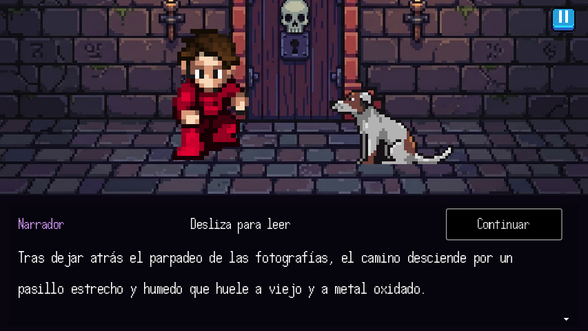
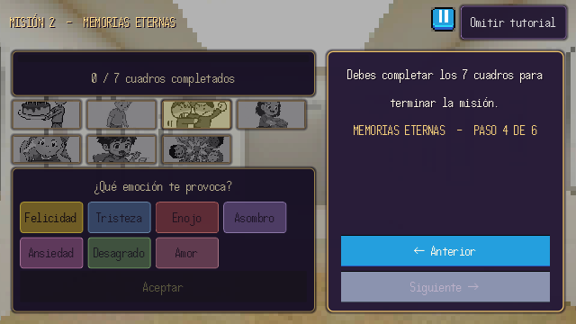
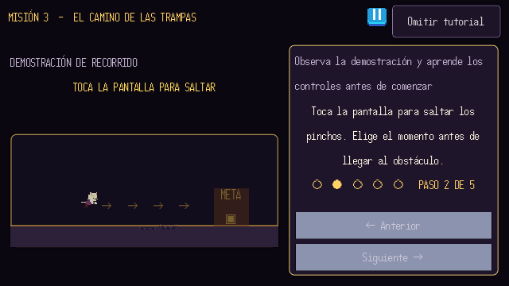
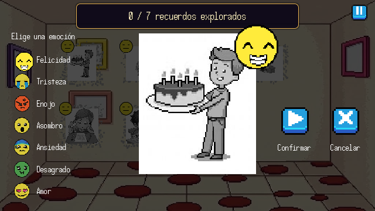

# Composición y comprensión en móvil — 3 de noviembre de 2026

La revisión anterior verificaba fuentes y cajas de texto. Esta pasada también comprueba si los diálogos ocultan personajes y si las instrucciones tapan las demostraciones, conservando los recursos, fuentes pixeladas, colores y animaciones del juego.

## Cambios

- **Diálogos:** panel inferior de altura estable, nombre y Continuar en una cabecera, texto desplazable y respuestas dentro del mismo panel. Las opciones ya no flotan sobre los actores. Los párrafos extensos conservan todo su contenido mediante desplazamiento.
- **Narrativa:** encuadre del lienzo sobre los actores, con una zona reservada encima del diálogo. Se conservan posiciones globales y unidades de movimiento de las coreografías. El encuadre se restaura al cambiar de escena, incluida la cámara de los minijuegos. Las referencias de sprites ocultas del editor se excluyen del cálculo. Se mantienen las entradas y salidas laterales intencionadas.
- **Cuatro tutoriales:** demostración a la izquierda e instrucciones a la derecha. Anterior / Siguiente / Iniciar permanecen fuera del área desplazable. Los rótulos de salto, puntería y puntuación tienen espacio propio fuera del recorrido del personaje o del martillo. Se adaptan las indicaciones a cruceta, joystick y toque; se amplía el personaje de la demostración del laberinto.
- **Memorias:** nombres permanentes junto a los siete iconos; se puede elegir tocando el icono o su nombre. Fotografía, opciones y acciones separadas, con espacio para ampliar la opción seleccionada. Confirmar y Cancelar tienen rótulos visibles.
- **Controles:** anclajes del joystick corregidos. La carrera automática oculta los controles direccionales y conserva el salto por toque. Sus letreros decorativos dejan pasar el contacto: antes podían impedir saltar al tocar sobre ellos.
- **Preguntas:** se conserva el ajuste de los pergaminos y se verifican nuevamente las 24 preguntas, sus cinco opciones y la separación entre cajas.

## Capturas

## Verificación

Godot 4.7.2, perfil móvil simulado a 854×480 y 640×360, con datos de usuario aislados. Las partidas reales no se utilizaron.

| Comprobación | Resultado |
|---|---|
| Actores, encuadre, 28 pasos de tutorial, navegación y controles táctiles | 604 comprobaciones, 0 fallos; 86 capturas OpenGL |
| Presentación, preguntas desde cero, desplazamiento, nombres de emociones y respuesta elegida con contacto inyectado | 689 comprobaciones, 0 fallos |
| Personalización en escritorio | 517 comprobaciones, 0 fallos |
| Validador existente de preguntas | 24 aprobadas en cada perfil, móvil y escritorio |
| Auditoría general de cajas y fuentes | 650 casos, 3008 muestras; sin recortes ni cajas fuera de pantalla sin desplazamiento |
| Último ajuste del tutorial de Memorias | 12 casos, 154 muestras, 12 capturas; 0 incidencias |

La auditoría general detectó una marca de verificación que bajaba de 14 píxeles nominales durante el pulso de una fotografía. Se elevó su fuente a 44, conservando el espacio de la caja; la pasada focalizada posterior verifica los seis pasos a ambas resoluciones. Se conservan ambos registros para mostrar el hallazgo y su corrección. Otra pasada visual general produjo 298 capturas.

Las muestras y registros están en `pruebas/resultados/composicion_movil_2026-11-03/`; las series completas permanecen en `.tmp_godot_mobile_pc/`. La prueba de composición verifica la altura reservada para los actores, conservando las entradas y salidas horizontales escritas en la historia.

## Límites

Es una simulación horizontal en PC. Falta validar comodidad de lectura, densidad real de pantalla, teclado virtual y gestos del sistema en un teléfono físico. El umbral nominal de 14 píxeles detecta textos pequeños; no certifica accesibilidad.

Se probaron escenas, pasos y casos de interfaz con sus scripts reales y contactos táctiles inyectados; no se realizó una partida humana completa de principio a fin. Las advertencias preexistentes de `dialogo_calma.mp3` y del actor `fran` al abrir aisladamente el prototipo `intro_mision_4` se conservan en los registros. Ese prototipo no pertenece al recorrido activo de la misión de saltos ni sustituye la escena de rescate.
