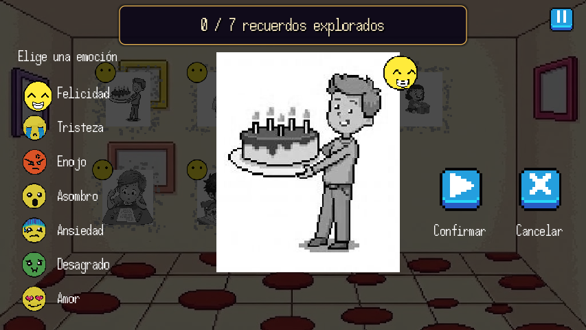
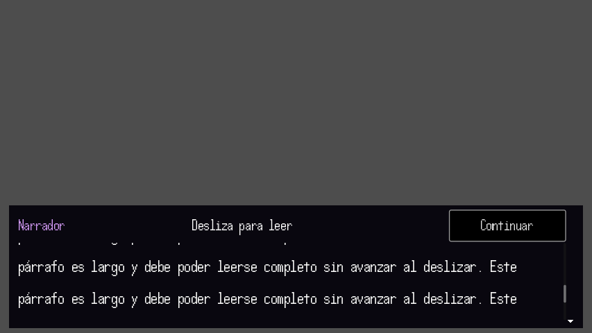
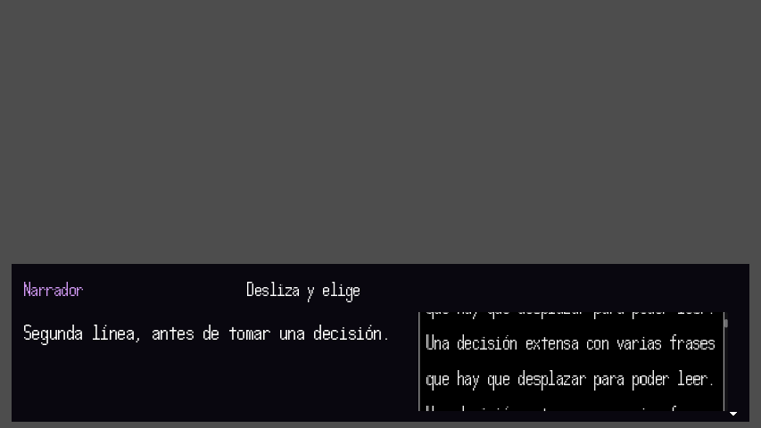

# Recuerdos y diálogos en teléfono — 15 de noviembre de 2026

Se reprodujeron los problemas reportados usando eventos de contacto en una copia
del proyecto con detección móvil activa y APPDATA independiente.

La puerta del cuestionario de Recuerdos estaba transparente y desactivada, pero
su zona táctil interceptaba el botón Confirmar del selector móvil. Ahora ignora
la entrada hasta que se revela al completar los siete recuerdos. Confirmar guarda
la emoción, actualiza el contador y cierra el dibujo; Cancelar no guarda cambios.

En teléfono, tocar o deslizar el cuerpo del diálogo ya no completa la escritura
ni cambia de línea. El botón Continuar completa primero la escritura, y una
segunda pulsación avanza. El atajo global de avance tampoco evita este botón.
El comportamiento de clic y teclado en escritorio se conserva.

El menú original elegía respuestas al presionar, antes de poder distinguir un
arrastre. Una subclase del proyecto usa ahora la pulsación al soltar de los botones
de Godot en móvil: el ScrollContainer cancela la selección cuando empieza el
desplazamiento. Las opciones conservan el ajuste de líneas y desplazamiento
vertical, con la indicación «Desliza y elige». El complemento no fue modificado.
Al cambiar de línea se reinicia también la posición de las opciones.

## Resultados

Godot 4.7.2, render OpenGL Compatibility, ventanas de 640×360 y 854×480:

- **163 comprobaciones móviles, cero fallos**, con render real y 20 capturas.
- **5 comprobaciones de escritorio, cero fallos**, para clic, teclado y decisiones.
- Suite de presentación móvil existente: **689 comprobaciones, cero fallos**.
- Carga e instanciación: **275 recursos, cero fallos**.

La suite nueva abre dibujos mediante entrada del viewport, alterna selección por
icono y nombre, cancela una elección, confirma las siete emociones y toca la puerta
para abrir el cuestionario. Para los diálogos genera un recurso de prueba con un
párrafo largo y cinco decisiones extensas. Comprueba arrastres mientras se escribe
y después de completar el texto, pulsaciones fuera del diálogo, elección al soltar
y acceso a la última respuesta después de desplazar.

No se utilizó un teléfono físico en esta validación. La exportación Android
actualizada queda pendiente de comprobar en el dispositivo del usuario.







## Repetir

Sincronizar los archivos modificados y la suite en `.tmp_godot_mobile_pc`, como
se describe en `pruebas/validacion/README.md`, y ejecutar:

```powershell
$env:APPDATA = Join-Path (Get-Location) '.tmp_godot_mobile_pc/recuerdos_render_userdata'
$env:EMO_TOUCH_OUTPUT = Join-Path (Get-Location) 'pruebas/resultados/recuerdos_dialogos_2026-11-15'
godot_console --path .tmp_godot_mobile_pc --rendering-method gl_compatibility --script res://pruebas/validacion/probar_recuerdos_dialogos_movil.gd
```

Con `--headless` se ejecutan las comprobaciones sin capturas. Con `--path .`
y otro APPDATA temporal, la misma suite comprueba el comportamiento de escritorio.
