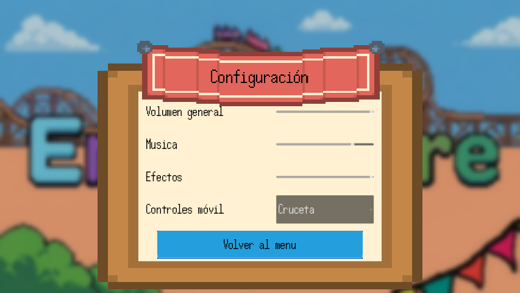
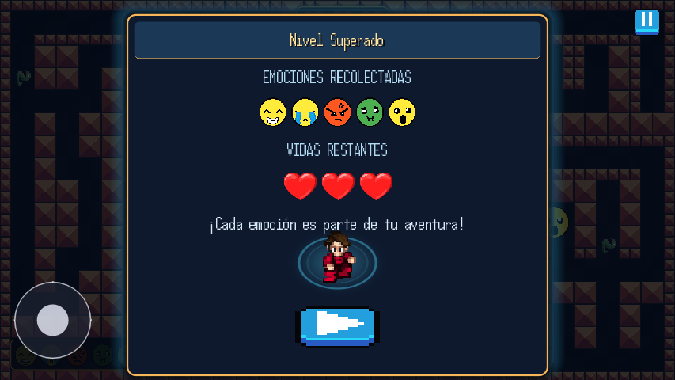
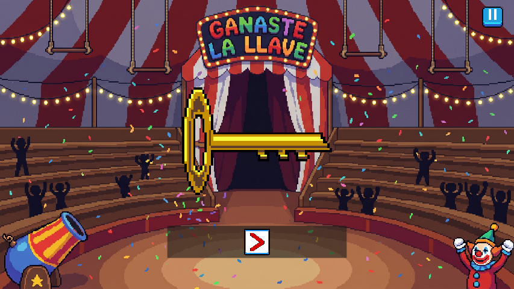

# Revisión de teléfono — 15 de noviembre de 2026

Se reprodujeron los controles fuera del interior del marco de configuración y
la victoria del laberinto con desplazamiento. La configuración ahora tiene
margen interior y espacio para el botón Volver. La victoria ajusta tamaños de
emociones, corazones y personaje para mostrar también Continuar en una pantalla,
conservando fuentes, ilustraciones y colores.

La pantalla vacía de la primera llave no se reprodujo en PC. Ambas recompensas
ocultaban su contenido con una escala de `0.00001` y dependían de una animación
para mostrar Continuar. Se eliminó esa dependencia: llave y botón se muestran
desde el inicio, y sólo se anima suavemente la opacidad de la llave. También se
centró el contenido y se corrigió la altura excesiva de la segunda recompensa.
Esto permite continuar incluso si la animación se detiene.

## Verificación

Godot 4.7.2, OpenGL Compatibility, perfiles APPDATA aislados y copia de prueba
con `MobileControlsSettings.is_mobile_device()` activado. No se usaron partidas
reales. No fue posible conectar un teléfono por ADB; falta validar el APK en
Android físico y confirmar allí la desaparición del problema original de la llave.

- Flujo móvil: **186 comprobaciones, cero fallos**, con render real y 15 capturas.
- Presentación móvil existente: **689 comprobaciones, cero fallos**.
- Flujo en escritorio: **23 comprobaciones, cero fallos**.
- Carga de recursos del proyecto: **273 recursos, cero fallos**.

Se solicitaron ventanas de 640×360, 854×480 y 1280×576. El proyecto conserva
su lienzo de juego 16:9; las capturas del área activa son respectivamente
640×360, 853×480 y 1024×576. En la última ventana queda espacio lateral fuera
del área de juego, como en las capturas del teléfono proporcionadas.

La suite `pruebas/validacion/probar_flujo_telefono.gd` verifica el interior del
marco, Cruceta y Joystick, la victoria con las cinco emociones y tres vidas,
la ausencia de desplazamiento, límites de pantalla y altura de botones.
Activa el fin de nivel por su controlador, pulsa Continuar, contesta el
cuestionario mediante eventos de entrada y comprueba la llegada a la primera
llave y al diálogo siguiente. Revisa además la segunda llave con animación
interrumpida, pausa y reanudación. Las pulsaciones incluyen contacto y el clic
emulado que usa la interfaz de Godot.

Los registros están en `pruebas/resultados/revision_telefono_2026-11-15/`.







## Repetir las pruebas

Sincronizar los archivos modificados y la suite en la copia aislada
`.tmp_godot_mobile_pc`, descrita en `pruebas/validacion/README.md`. Después:

```powershell
$env:APPDATA = Join-Path (Get-Location) '.tmp_godot_mobile_pc/phone_render_userdata'
$env:EMO_PHONE_OUTPUT = Join-Path (Get-Location) 'pruebas/resultados/revision_telefono_2026-11-15'
godot_console --path .tmp_godot_mobile_pc --rendering-method gl_compatibility --script res://pruebas/validacion/probar_flujo_telefono.gd
godot_console --headless --path .tmp_godot_mobile_pc --script res://pruebas/validacion/probar_presentacion_movil.gd
```

Para escritorio, usar `--path .`, un APPDATA temporal diferente y la misma
suite de flujo. Se puede omitir `EMO_PHONE_OUTPUT` para no guardar capturas.
